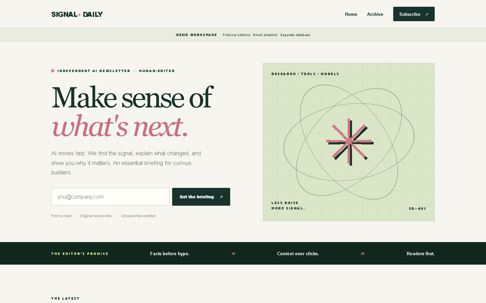
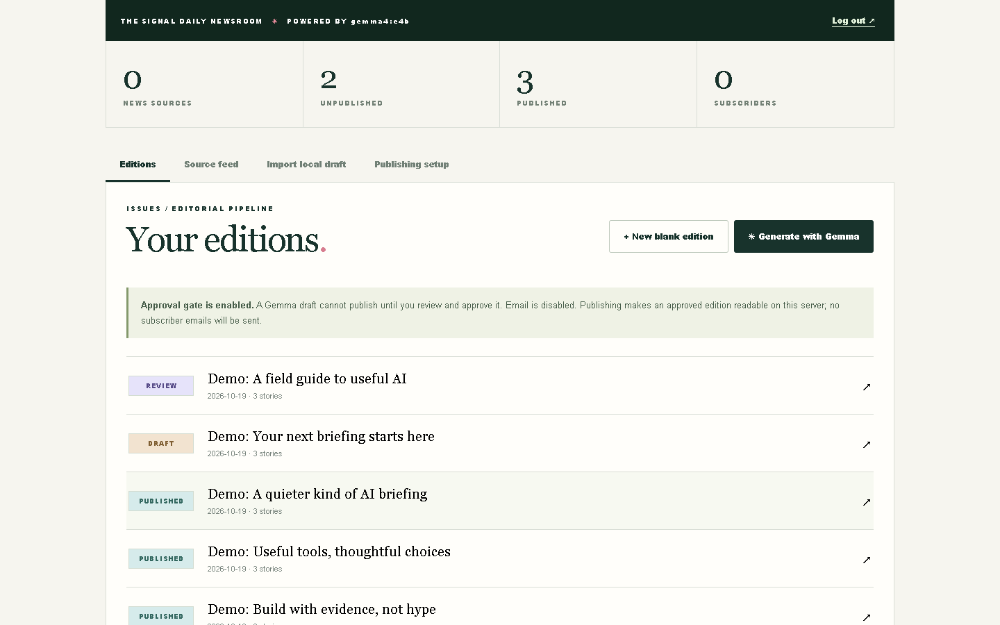
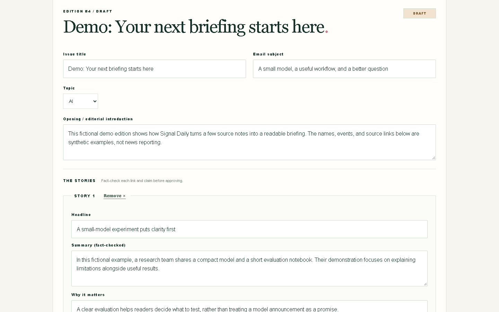
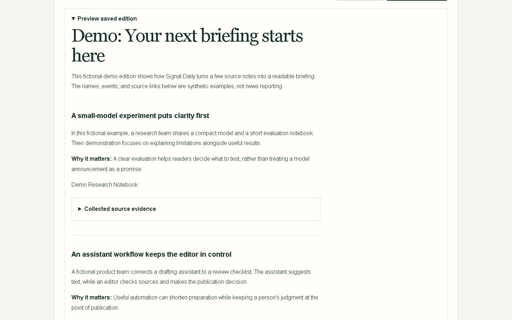
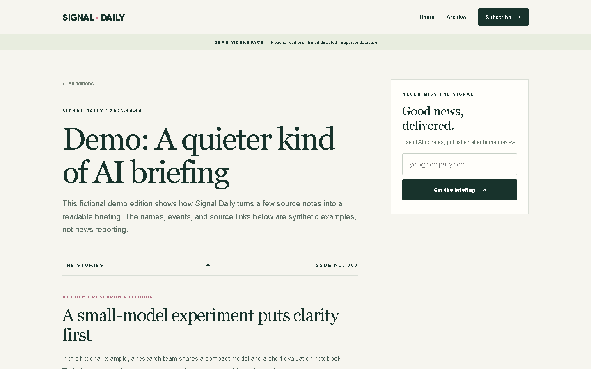
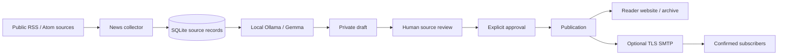

# Signal Daily

**An open-source, locally powered AI newsletter platform with human-controlled publishing.**

[](https://github.com/YellankiKaushik/AI-el-bolet-n/actions/workflows/tests.yml)
[](https://www.python.org/downloads/)
[](NOTICE)
[](https://ollama.com/)

Turn a busy AI news feed into a briefing you can stand behind. Signal Daily collects RSS stories, asks a Gemma model running on your own computer to prepare a draft, and gives you a browser workbench to check sources, edit the text, and decide when to publish.

Local drafting, retained source evidence, and a mandatory approval gate keep the editorial decision with you. You can publish a readable website edition without configuring email, or add verified subscriber delivery later. No cloud AI subscription is required.

**Working locally. Public newsletter service not deployed. Email disabled by default.** GitHub hosts this source code; it does not run the newsletter server. See [project status](docs/PROJECT_STATUS.md) for tested capabilities and remaining production requirements.

The [final engineering report](docs/FINAL_ENGINEERING_REPORT.md) records the 20 October 2026 acceptance: 97 automated tests, 75 fresh browser scenarios, actual Linux container/Caddy checks and strict scans of both images passed. Deployment needs a connected host with persistent storage and encrypted off-host backups.

For independent technical review, start with the [master report index](docs/MASTER_REPORT_INDEX.md), [complete project status](docs/COMPLETE_PROJECT_STATUS.md) and [report publication summary](docs/REPORT_PUBLICATION_SUMMARY.md).



*Actual application rendering, captured with Playwright. All gallery editions are fictional demo fixtures in a separate database; no real subscribers, private drafts, credentials or tokens appear.*

[Get started](docs/GETTING_STARTED.md) · [User guide](docs/USER_GUIDE.md) · [Manual testing](docs/LOCAL_TESTING_GUIDE.md) · [Troubleshooting](docs/TROUBLESHOOTING.md) · [Architecture](docs/ARCHITECTURE.md)

## From sources to an edition

| Capability | What you can do |
|---|---|
| RSS / Atom collection | Refresh configured public HTTPS feeds, deduplicate URLs, and select relevant, recent source records. Partial feed failures are reported. |
| Local Gemma drafting | Use an installed Ollama tag such as `gemma4:e4b`. The client requests structured JSON and retains the selected source links and evidence. |
| Editorial control | Edit title, email subject, topic, introduction, stories and closing. Preview the saved edition and inspect its history. |
| Mandatory human approval | Move through **Draft → Review → Approved → Published**. Saving resets approval; unsaved edits block approval/publication. |
| Edition management | Start blank editions, import complete JSON, request revisions and keep unpublished work private. Published editions are immutable. |
| Reader website | Browse the homepage, read individual published editions, and search the paginated archive by text and topic. |
| Consented subscriptions | Optional email registration uses a one-use, 24-hour confirmation link. Unsubscribe GET shows a confirmation; POST removes consent. |
| Optional email distribution | TLS SMTP sends HTML/plain-text editions to active subscribers in bounded batches, with persistent duplicate-send reservations and cautious handling of uncertain sends. Live provider delivery still needs acceptance testing. |
| Persistence and recovery | SQLite stores sources, editions, consent, delivery state and history. Versioned migrations and a verified backup/restore tool preserve existing data. |
| Security controls | Protected editor APIs, expiring signed sessions, CSRF checks, input limits, source/output validation, private configuration and production proxy safeguards. These reduce risk; they are not a claim of absolute security. |
| Automated checks | Unit/integration tests cover state transitions, HTTP access, generation validation, migrations, backup/restore, consent, delivery and safe local startup. External SMTP/model responses are mocked in the suite. |

The AI sees feed headlines/descriptions, not necessarily full articles. It can still misstate facts or implications. **Open the original links and check the draft before approving it.**

## A look inside

| Editorial workbench | Draft editor |
|---|---|
| [](docs/screenshots/editor-dashboard.png) | [](docs/screenshots/newsletter-editor.png) |
| Manage edition states and keep email off. | Edit the saved content before review. |

| Saved preview | Published reader view |
|---|---|
| [](docs/screenshots/newsletter-preview.png) | [](docs/screenshots/published-edition.png) |
| Inspect the exact saved revision and source evidence. | A publication on localhost is visible only on that machine. |

<p align="center">
  <a href="docs/screenshots/homepage-mobile.png"></a>
</p>

*Mobile rendering at 390 × 844 CSS pixels, captured at 2× density. [Screenshot provenance, dimensions and reproduction](docs/screenshots/README.md). Click gallery images for their full-resolution versions.*

## How it works



Everything can run on your laptop. If you later host the website, keep Ollama private on the laptop: generate JSON locally and import it through the hosted authenticated editor. Do not expose port 11434 or create an internet tunnel to Ollama. [Technical boundaries and hosted architecture](docs/ARCHITECTURE.md).

## Technology stack

| Layer | Actual implementation |
|---|---|
| Backend | Python 3.11+; local standard-library HTTP server |
| Frontend | Server-rendered HTML, original CSS and plain JavaScript; no frontend build step |
| Storage | SQLite with WAL, transactions, migrations and delivery reservations |
| AI | Local Ollama `/api/chat`, installed Gemma model, JSON schema/output validation |
| Sources | Bounded public HTTPS RSS / Atom ingestion |
| Mail | Python SMTP with STARTTLS / implicit TLS, optional and disabled by default |
| Prepared production serving | Waitress WSGI behind Caddy, one instance and persistent SQLite storage |
| Packaging | Dockerfile / Compose configuration; Docker runtime remains unverified on the development laptop |
| Quality | unittest, Ruff, Bandit, Node syntax checks and OSV package audit |

Local `run.py` needs no pip packages. Production serving adds pinned [Waitress](requirements.txt); tests/checkers use [requirements-dev.txt](requirements-dev.txt). Playwright/Sharp are optional maintainer screenshot tools, not application dependencies.

## Quick start on Windows

Install [Python](https://www.python.org/downloads/windows/) (CI covers 3.11 and 3.12), [Git](https://git-scm.com/downloads/win) and [Ollama](https://ollama.com/download/windows). Open a new PowerShell window after installation. No Docker or SMTP account is required for local use.

```powershell
git clone https://github.com/YellankiKaushik/AI-el-bolet-n.git
Set-Location AI-el-bolet-n
py -3 --version
py -3 tools/setup_local.py
ollama list
```

Setup creates an ignored `.env` with random credentials and never overwrites an existing file. Open `.env` privately in your editor; select the exact installed model tag with `OLLAMA_MODEL`. Start the Ollama application. `gemma4:e4b` was tested on the development laptop; other tags/hardware need their own check. Only if the model is missing and you choose to download its weights, run `ollama pull gemma4:e4b` first. Do not use a `:cloud` model for this local workflow.

```powershell
.\Start-Local.ps1
```

The launcher finds a working Python, binds `127.0.0.1:8787`, enables local drafting and disables live mail. Keep its terminal open. If PowerShell blocks scripts or `py` is unavailable, follow the [direct-executable alternatives](docs/GETTING_STARTED.md); do not change security policy just to start the app.

- Homepage: [http://localhost:8787](http://localhost:8787)
- Editor: [http://localhost:8787/admin](http://localhost:8787/admin)
- Log in with `ADMIN_PASSWORD` from your private `.env`. There is no separate username. Never paste the password into GitHub.

An empty public archive is normal until you choose to publish. Use Ctrl+C in the server terminal to stop it; the same command restarts it with its existing database. [Complete beginner setup](docs/GETTING_STARTED.md).

## Publish your first local newsletter

1. In **Source feed**, select **Refresh news sources**. Zero additions can mean the URLs are already cached.
2. Select relevant stories and choose **Generate selected with Gemma**. Up to eight selected inputs are used; generation returns one to six items.
3. Open every original source and check dates, attribution, numbers, claims and implications. Keep unsupported text out of the edition.
4. Edit the title, email subject and story fields. Select **Save as draft** and expand **Preview saved edition**.
5. Select **Submit for review**, check the saved revision, then deliberately choose **Approve reviewed edition**. The same account can perform both steps; this is not two-person approval.
6. With email disabled, choose **Publish online only** and confirm only when you are ready. On the laptop this means localhost, not a public deployment.
7. Verify the edition on the homepage and **Archive**. Published editions are immutable; plan corrections before publishing.

Practice repeatably with fictional content instead of real news:

```powershell
py -3 tools/demo.py
```

This starts a separate, clearly marked workspace at [http://127.0.0.1:8789](http://127.0.0.1:8789). Read its demo password privately from `.tmp/demo/credentials.json`. It cannot seed the real database; email and generation are disabled. [Step-by-step manual acceptance guide](docs/LOCAL_TESTING_GUIDE.md).

## Tests

```powershell
py -3 -m pip install -r requirements.txt -r requirements-dev.txt
py -3 -m unittest discover -s tests -v
py -3 -m ruff check .
py -3 -m ruff format --check .
py -3 -m compileall -q db.py server.py production.py instance.py feeds.py llm.py mailer.py config.py validation.py run.py tools tests
node --check static/app.js
node --check tools/capture_screenshots.cjs
py -3 -m bandit -q -r . --exclude ./.tmp,./tests,./.venv,./data,./backups
py -3 tools/check_docs.py
py -3 tools/release_audit.py
```

Node is only needed for JavaScript/screenshot checks. The release report records the exact final test count and CI outcome; do not treat an older report's count as the current suite. The [four-job CI matrix](.github/workflows/tests.yml) checks Windows/Linux with Python 3.11/3.12. [Manual tests and recovery instructions](docs/LOCAL_TESTING_GUIDE.md).

## Local, GitHub, hosting and email are separate

| Environment | What it provides | Current status |
|---|---|---|
| Laptop / localhost | The running application, local model and private SQLite data | Verified working |
| GitHub repository | Source, documentation, screenshots and CI | Source hosting; no running newsletter service |
| Public website host | HTTPS reader site, restricted editor, persistent storage and operations | Not deployed; requires separate authorization and acceptance |
| SMTP provider | Confirmation and subscriber messages | Implemented and mocked; real provider/inbox acceptance unverified |

Use the [production runbook](docs/PRODUCTION_RUNBOOK.md) only when intentionally preparing a future host. Do not expose the development server. Keep one application instance, private durable storage, encrypted off-host backups and monitored delivery state.

## Security and privacy

- Keep `.env`, SQLite/WAL files, backups, local drafts and model weights outside Git. Ignore rules and the candidate audit help enforce this.
- The editor uses a configured password, signed expiring cookies, CSRF checks and throttling. Production adds HTTPS/proxy validation and persistent client limits. No MFA, recovery workflow or separate editor roles exist.
- Only active, confirmed subscribers are eligible for mail. Unsubscribe requires POST, and uncertain sends are held for manual provider reconciliation rather than retried blindly.
- Model requests are restricted to loopback, with no automatic cloud fallback. RSS collection and opening source links still contact those publishers.
- Backups contain private consent/tokens as well as editions. Use restricted encrypted storage and rehearse restoration; restoring an old delivery ledger can duplicate newer mail unless reconciled.
- Do not post credentials or subscriber details in issues. See [security reporting](CONTRIBUTING.md#security-reporting) and [current limitations](docs/PROJECT_STATUS.md).

## Project map

```text
.
├── run.py / Start-Local.ps1   # Safe laptop startup
├── server.py                # Public HTML and protected editor APIs
├── db.py                    # Schema, workflow, history and delivery ledger
├── feeds.py                 # RSS / Atom collection and filtering
├── llm.py                   # Grounded loopback Ollama generation
├── mailer.py                # SMTP configuration, templates and delivery
├── validation.py            # Shared content / email / URL validation
├── config.py / instance.py  # Private config and OS process lock
├── production.py            # Bounded Waitress transport and proxy checks
├── static/                  # Original CSS and browser JavaScript
├── tools/                   # Setup, demo, collection, JSON, backup and audits
├── tests/                   # Isolated unit and HTTP regression suites
├── docs/                    # User, developer and historical evidence guides
│   ├── examples/            # Explicitly fictional manual-test fixture
│   └── screenshots/         # Real browser captures and provenance
├── deploy/Caddyfile         # Prepared HTTPS reverse-proxy configuration
└── Dockerfile / compose.yaml
```

Private `data/`, `backups/`, `local-drafts/`, `.tmp/` and `.env` appear only after local use; they are not clone contents.

## Roadmap

| Category | Work |
|---|---|
| Completed | Local Gemma workflow, source evidence, review/approval gate, reader archive, mocked consent/delivery, migrations, local backup/restore, safe Windows startup, synthetic demo, guides and actual Linux container/Caddy/image-scan acceptance |
| Awaiting external acceptance | Persistent hosting, public TLS/ingress, installed operations, sender DNS, inbox acceptance and encrypted off-host disaster recovery |
| Planned | Background delivery workers, bounce/complaint synchronization, multi-editor roles/MFA/recovery, correction/takedown tools and retention controls |

[Detailed project status](docs/PROJECT_STATUS.md) distinguishes implementation from external verification. These are directions, not promised release dates.

## Contributing

Start with [CONTRIBUTING.md](CONTRIBUTING.md), run the checks, and keep changes focused. Use isolated synthetic data for publication tests and screenshot updates. A pull request should explain the behavior changed, evidence, and relevant limitations. Never include private configuration, databases or subscriber records.

## Documentation library

- [Getting started](docs/GETTING_STARTED.md), [user guide](docs/USER_GUIDE.md), [manual testing](docs/LOCAL_TESTING_GUIDE.md)
- [Architecture](docs/ARCHITECTURE.md), [configuration](docs/CONFIGURATION.md), [troubleshooting](docs/TROUBLESHOOTING.md)
- [Project status](docs/PROJECT_STATUS.md), [production runbook](docs/PRODUCTION_RUNBOOK.md)
- [Final engineering report](docs/FINAL_ENGINEERING_REPORT.md), [test results](docs/FINAL_TEST_RESULTS.md), [deployment and blockers](docs/FINAL_DEPLOYMENT_REPORT.md)
- [Documentation release report](docs/GITHUB_DOCUMENTATION_REPORT.md)
- [Historical evidence index](docs/HISTORY.md)

## License and acknowledgments

The repository's pre-existing [Apache License 2.0 text](LICENSE) is retained. The supplied application's [MIT notice](LICENSES/Signal-Daily-MIT.txt) is preserved separately. [NOTICE](NOTICE) explains provenance; this README does not assert a new blanket dual-license grant.

Signal Daily uses its own original visual design and text. Public newsletter behavior informed an earlier comparison, documented in [REA_ANALYSIS.md](docs/REA_ANALYSIS.md). REA was an optional investigation tool, not a runtime dependency; a successful REA capture or private backend recovery is not claimed. Signal Daily is not affiliated with The Rundown AI.
