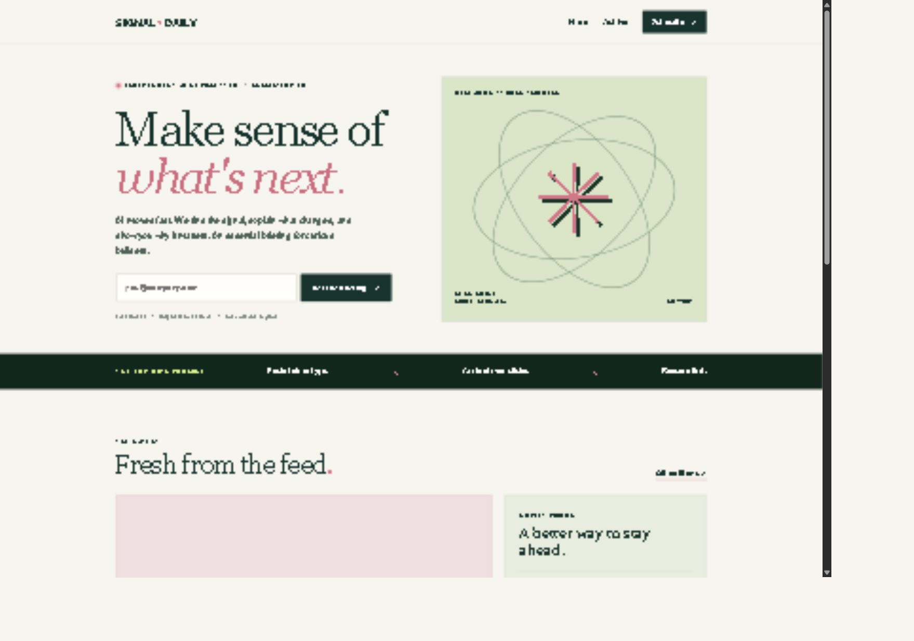

# Signal Daily

**A source-grounded AI newsletter, drafted locally and published after human review.**

Signal Daily collects AI news from RSS/Atom feeds, drafts editions with a local Ollama model, and gives an editor control over review, approval, publication and subscriber delivery.

**Collect → DRAFT → REVIEW → APPROVED → PUBLISHED → confirmed subscribers**

This repository contains the application source. The public newsletter service is **not deployed**. Fresh clones contain no credentials, database, generated editions or subscriber records.



## Features

- Original responsive homepage, individual edition pages and a searchable, paginated topic archive.
- Local Gemma generation from collected source material, with source identity validation and preserved attribution.
- Protected editor: manual drafts, JSON import, editing, previews, source evidence, revision requests and edition history.
- Mandatory review and approval before publication; saved changes reset approval and published editions are immutable.
- Double opt-in subscriptions, expiring confirmation links and confirmed unsubscribe actions.
- TLS SMTP delivery with HTML/plain-text messages, bounded batches and persistent duplicate-delivery protection.
- SQLite migrations, operational logs, a schedule-friendly ingestion CLI and automated checks.

## Technology and architecture

| Layer | Implementation |
|---|---|
| Backend | Python 3.11+ standard library, bounded HTTP server |
| Frontend | Server-rendered HTML, CSS and plain JavaScript |
| Persistence | SQLite with migrations, transactions and delivery reservations |
| Local AI | Ollama HTTP API; configurable installed model tag |
| Sources | Public HTTPS RSS/Atom feeds |
| Delivery | SMTP with STARTTLS or implicit TLS |
| Checks | unittest, Ruff, Bandit, Node syntax check, OSV advisory audit |

There are **no third-party runtime Python or npm dependencies**. Developer checker dependencies are pinned separately in [requirements-dev.txt](requirements-dev.txt).

```text
RSS/Atom → feeds.py → SQLite stories → local Ollama draft
                                          ↓
                       protected editor → review → approval → publish
                                          ↓                    ↓
                                    edition history       public website
                                                               ↓
                                                    confirmed subscribers
                                                    SMTP + delivery ledger
```

Core ownership: [db.py](db.py) stores state and enforces transitions; [validation.py](validation.py) validates imported/generated content; [llm.py](llm.py) owns local generation; [server.py](server.py) serves public and protected routes; [mailer.py](mailer.py) renders and sends emails.

## Quick start

Install Python 3.11+ and Git, then run:

```powershell
git clone https://github.com/YellankiKaushik/AI-el-bolet-n.git
cd AI-el-bolet-n
python tools/setup_local.py
python run.py
```

On Windows, use `py` instead of `python` if that is how your Python installation is registered. If neither runs, install Python and verify the executable path first. A machine-specific Codex runtime workaround is retained in the [deployment guide](docs/DEPLOYMENT_GUIDE.md).

Setup creates an ignored `.env` with random administrator credentials only if it does not already exist. Existing configuration is preserved. Read `ADMIN_PASSWORD` locally in `.env`, then open:

- Public website: [http://localhost:8787](http://localhost:8787)
- Editor: [http://localhost:8787/admin](http://localhost:8787/admin)

The private SQLite database is initialized automatically. Empty public pages are expected until an editor approves and publishes an edition. Never commit `.env`, databases, local drafts or subscriber records.

## Local Gemma setup

Start your installed Ollama service and inspect `ollama list` or `http://127.0.0.1:11434/api/tags`. Set the **exact installed tag** in `.env`:

```dotenv
OLLAMA_URL=http://127.0.0.1:11434
OLLAMA_MODEL=gemma4:e4b
OLLAMA_TIMEOUT=240
```

`gemma4:e4b` was verified on the original development laptop; other installations may differ. No model weights are included or automatically downloaded. Requests stay on loopback and never fall back to a paid cloud API.

The model uses source headlines/descriptions rather than its training memory for current news. The client rejects malformed output, unknown/duplicate source identities, inline model-generated URLs and detectable new numeric claims. These checks cannot establish semantic factual accuracy: the editor must verify claims against original sources.

## Editorial workflow

1. Open **Source feed → Refresh news sources**, select 1–8 stories, and generate a draft. Alternatively start a manual edition or import JSON.
2. Edit the subject, title, topic, introduction, stories, source links and closing; save.
3. **Submit for review**, preview the saved revision and check the source evidence.
4. **Approve reviewed edition** or request revision. Unsaved edits block approval/publication; saving resets approval.
5. **Publish + notify subscribers** explicitly publishes online and, when SMTP is configured, sends a bounded batch to confirmed active subscribers.
6. Use **Send / retry** for remaining or safely failed deliveries. Sent, in-flight and uncertain deliveries are excluded.

## Sources and scheduled collection

Default feeds include Hugging Face, MIT Technology Review AI, arXiv AI and The Verge AI.

```powershell
python tools/collect_news.py
```

The one-shot collector never generates, approves, publishes or emails. Schedule it using your operating system's scheduler with the project working directory. No schedule is installed automatically.

Configure `RSS_FEEDS`, `RSS_LIMIT`, `RSS_MAX_AGE_DAYS`, `RSS_RETRIES` and `RSS_KEYWORDS` as needed. Collection has feed/record/time/retry bounds, canonical URL deduplication, relevance/recency filtering and partial-failure reporting. Only UTF-8 XML without DTD/entity declarations is accepted. Undated records remain undated.

## Subscriptions and SMTP

Configure these placeholders privately in `.env` and restart:

```dotenv
SMTP_HOST=smtp.your-provider.com
SMTP_PORT=587
SMTP_USER=your-smtp-username
SMTP_PASSWORD=your-smtp-password
MAIL_FROM=Signal Daily <newsletter@your-domain.com>
PUBLIC_URL=https://news.your-domain.com
```

STARTTLS is required on port 587; port 465 or `SMTP_SSL=true` selects implicit TLS. Public subscriptions stay unavailable until SMTP is configured. A generic subscription response and one-time 24-hour confirmation protect consent and privacy. Only confirmed active subscribers receive editions; unsubscribe requires a confirmation POST.

Delivery defaults to 25 recipients per action, capped at 100. The ledger prevents duplicate concurrent dispatch. SMTP acceptance can be ambiguous after a disconnect: `sending`/`uncertain` rows require provider-log reconciliation before retry. See the [operations guide](docs/DEPLOYMENT_GUIDE.md).

## Keep laptop AI private when hosting

Host the website separately on a persistent Python server and generate drafts locally:

```powershell
New-Item -ItemType Directory -Force local-drafts
python tools/local_generate.py --output local-drafts/edition.json
```

Import the JSON through the hosted, authenticated HTTPS editor, then review and approve it. The cloud host's `localhost` is not your laptop. Do not expose Ollama publicly. Automatic upload/worker polling is not configured.

All supported environment variables are documented in [.env.example](.env.example) and the [deployment guide](docs/DEPLOYMENT_GUIDE.md).

## Tests and quality checks

```powershell
python -m pip install -r requirements-dev.txt
python -m unittest discover -s tests -v
python -m ruff check .
python -m ruff format --check .
python -m compileall -q db.py server.py feeds.py llm.py mailer.py config.py validation.py run.py tools tests
node --check static/app.js
python -m bandit -q -r . --exclude ./.tmp,./tests,./.venv,./data
python tools/release_audit.py
python tools/audit_dependencies.py
```

Node is needed only for the optional local JavaScript check. Tests use temporary SQLite databases, loopback HTTP and mocked external transports; they send no real email. The publication pass independently reran all **56 tests**. The [CI workflow](.github/workflows/tests.yml) defines Windows/Linux jobs for Python 3.11/3.12; current hosted results are visible in [GitHub Actions](https://github.com/YellankiKaushik/AI-el-bolet-n/actions).

## Documentation

- [Implementation and architecture decisions](docs/IMPLEMENTATION_REPORT.md)
- [Test report and evidence](docs/TEST_REPORT.md)
- [Resolved issues and remaining limitations](docs/ISSUE_REPORT.md)
- [REA investigation and public-reference evidence](docs/REA_ANALYSIS.md)
- [Deployment and operations guide](docs/DEPLOYMENT_GUIDE.md)
- [Local engineering push checklist](docs/GITHUB_PUSH_CHECKLIST.md)
- [GitHub publication record](docs/GITHUB_PUBLICATION_REPORT.md)

REA is a separate optional investigation tool. Its source is not bundled or required at runtime. The investigation recorded a missing compiled REA runtime and public-page observations, without claiming a successful REA capture or private backend recovery.

## Production status and limits

The website remains **undeployed**. Launch requires an HTTPS host, strong production configuration, persistent private storage, backups/restoration testing, SMTP/sender DNS and a consented mailbox acceptance test. The retained standard-library HTTP server needs production serving-layer/edge hardening and load testing. Use one application process; distributed queues, shared rate limits, bounce/complaint handling, account recovery and multi-editor roles are deferred.

## Licensing and reference

The application retains its supplied [MIT license notice](LICENSES/Signal-Daily-MIT.txt). The destination repository's pre-existing [Apache License 2.0 text](LICENSE) and original commit are preserved unchanged; see [NOTICE](NOTICE) for provenance. No new blanket dual-license grant is asserted.

Signal Daily's appearance and content are original. General public newsletter patterns were studied on [The Rundown AI](https://www.therundown.ai/); this project is not affiliated with that publisher.
