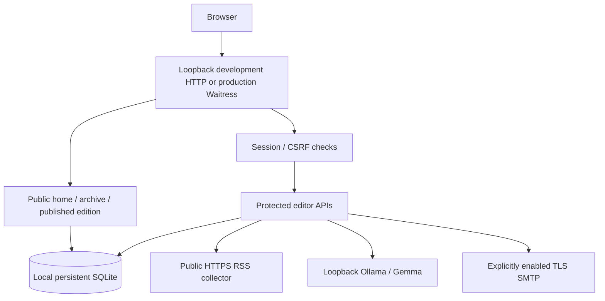
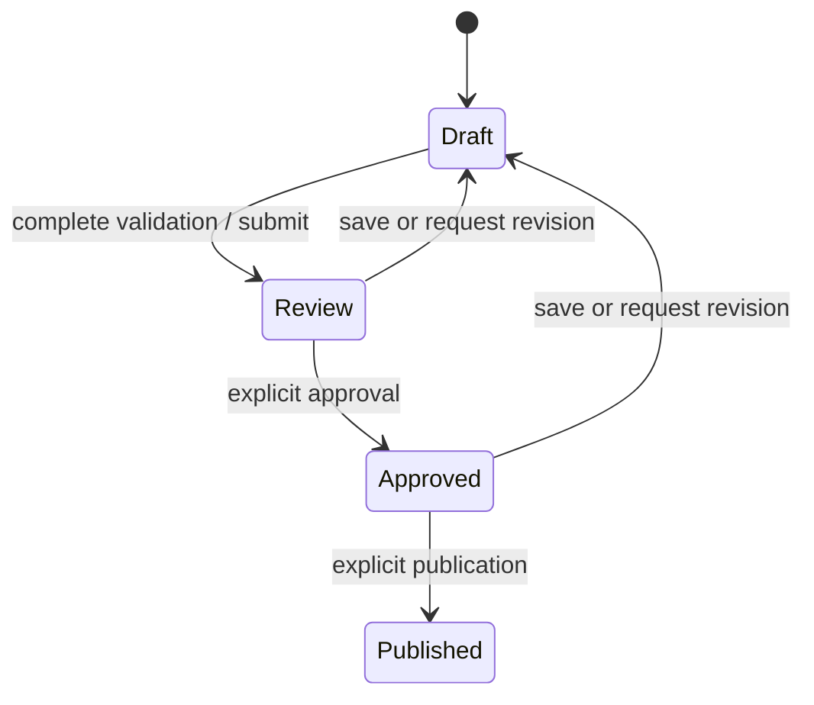
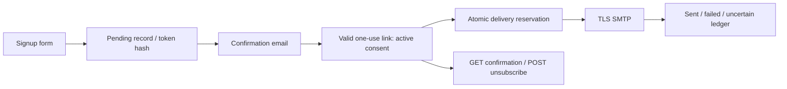
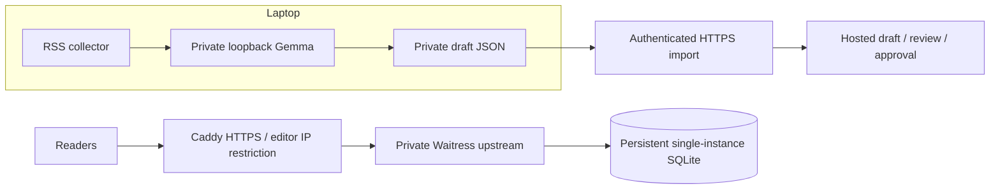

# Architecture

Signal Daily is a small, single-instance Python application with server-rendered pages, plain browser JavaScript and local SQLite. The supported laptop entry point is `run.py` (or `Start-Local.ps1`). Production transport is prepared separately in `production.py`; source hosting on GitHub does not deploy either entry point.

## Components and ownership

| Component | Responsibility |
|---|---|
| `config.py` | Read UTF-8/BOM `.env` without overriding process environment values |
| `run.py`, `Start-Local.ps1` | Local startup, loopback enforcement, mail-off defaults; Windows interpreter detection |
| `server.py` | Shared HTML rendering, HTTP/API routes, sessions, CSRF, ingestion and bounded synchronous delivery |
| `static/app.js`, `static/style.css` | Browser workbench, save/dirty-state controls, previews, form feedback and original responsive presentation |
| `db.py` | Connection ownership, schema migrations, editorial transactions, history and delivery claims |
| `validation.py` | Bounded shared issue/email/URL validation and source URL canonicalization |
| `feeds.py` | Public HTTPS RSS/Atom retrieval, redirect checks, XML boundary, recency/relevance and dedupe |
| `llm.py` | Loopback-only Ollama request, grounded prompt/schema and output/source checks |
| `mailer.py` | SMTP validation, TLS transport, multipart templates and acceptance ambiguity |
| `instance.py` | OS-backed process lock on a database path; Windows `msvcrt` / POSIX `flock` |
| `production.py` | WSGI adapter sharing routes without using the development HTTP parser; Waitress limits and proxy trust |
| `tools/` | Setup, collection, JSON generation, safe synthetic demo, backups, audits and optional screenshot capture |

## Request and data flow

The browser sends JSON mutations with `X-Signal-Request: 1` and same-origin credentials. A login derives/compares a password hash and returns an expiring HMAC-signed cookie. APIs check authorization before editorial operations. SameSite cookies, the custom header and Origin validation protect mutations. Public pages query only published editions; the editor shell alone does not reveal private data.

Local serving uses a bounded standard-library HTTP server, intended only for loopback use. Production's adapter translates WSGI requests to the shared route methods; Waitress parses HTTP, applies body/header/channel limits and resolves only explicitly trusted proxy headers. Production host/scheme checks precede routing. HTTPS cookies use Secure/HttpOnly/SameSite=Strict, and sensitive pages use no-store/security headers.

## SQLite storage

| Table | Records and invariants |
|---|---|
| `stories` | Unique canonical source URLs, title, publisher, description and source date |
| `issues` | Unique slug, content JSON, topic, state, optimistic revision version and timestamps |
| `issue_events` | Edition action and saved content snapshot for its history |
| `subscribers` | Unique email, pending/active/unsubscribed consent, confirmation hash/expiry and stable unsubscribe token |
| `deliveries` | Unique edition/subscriber pair; sending/sent/failed/uncertain states |
| `operations` | Bounded-detail ingestion/delivery diagnostics without credential/recipient payloads |
| `rate_limits` | Production throttle windows keyed by HMAC-hashed client identity |

Connections enable foreign keys, WAL and a busy timeout, then commit/rollback and close on context exit. Schema version 1 rebuilt workflow/delivery tables and added metadata/confirmation expiry; version 2 adds persistent throttles. Startup migrations preserve existing rows and reject unsupported newer schemas. Edition mutations and claims use immediate transactions where needed.

There is one application process per local database, guarded by an OS lock. The architecture assumes a local persistent filesystem, not NFS/SMB or multiple hosts. The online backup tool uses SQLite's backup API so committed WAL content is included, checks integrity/foreign keys, and refuses overwrites. Restore creates a new locked path; it never replaces the live database. Restoring an old ledger requires reconciling newer provider acceptances before mail resumes.

## AI drafting boundary

1. Collect bounded public HTTPS feeds with a finite retry/time budget. Resolve/validate destinations and redirect targets; reject private addresses, oversized responses, unsupported encodings and DTD/entity XML.
2. Parse RSS/Atom, normalize URLs, filter configured age/relevance and store distinct records. Missing source dates remain missing; unsupported dates are not invented.
3. Choose up to eight source records. One generation at a time sends IDs, headlines, descriptions, publishers and links to loopback Ollama `/api/chat`.
4. Use the configured installed model, `stream=false`, structured schema, finite timeout/context/output and an instruction that source text is untrusted data.
5. Validate JSON shape, one to six items, known unique integer source IDs, required prose, absence of invented inline URLs, and detectable new numeric claims in headlines/summaries.
6. Attach source URLs/provenance from the original input records; validate again and save a draft. No model output can grant approval.

These checks are deliberately conservative and incomplete: semantic errors, misleading implications, incomplete RSS excerpts and prompt injection still require human review. There is no automatic full-article fetch or cloud-model fallback.

## Editorial state machine

Imports always start as draft. Incomplete manual drafts can be saved but cannot enter review. Saves use optimistic version checks, reset approval and record history. UI dirty state disables approval/publication so visible unsaved content cannot masquerade as approved saved content. Published editions are immutable. One account performs review/approval; there is no independent second approver or correction/takedown UI.

## Subscription and delivery

Subscription replies are generic to avoid enumerating active addresses. Confirmation hashes expire after 24 hours; unsubscribe tokens remain stable across repeat pending subscriptions. Unsubscribe GET does not change consent; POST does. A message already in flight cannot be recalled.

Email is off by default in supported entry points/setup. When deliberately enabled, publishing also starts the first synchronous batch. Atomic claims and active-consent rechecks prevent common duplicates/races. Safe SMTP rejection can be retried; DATA disconnects become uncertain, and interrupted sending claims remain held. A QUIT failure after known acceptance must not make a message retryable. SMTP acceptance is not an inbox-delivery guarantee or exactly-once protocol.

No background queue, bounce/complaint webhook or provider suppression synchronization is implemented. Use small batches and manual provider reconciliation; a request timeout may leave work in progress.

## Local versus future hosted mode

The prepared Compose architecture publishes only Caddy's 80/443, trusts one fixed private proxy IP, uses a non-root read-only application container and persistent data/certificate volumes, and disables hosted generation. Never expose Ollama or the backend port to the internet. Docker, live TLS/ingress, sender DNS/inbox acceptance and off-host recovery remain external acceptance tasks; none is proven by the presence of a config file. [Production runbook](PRODUCTION_RUNBOOK.md).

## Failure handling and limits

Feed errors are reported by source/type without fake replacements. Generation/network/validation failures do not save partial model output or fall back to a cloud API. API errors return bounded messages; unexpected failures omit stack traces to clients. Logs redact token-bearing paths; unredacted proxy/debug access logs should remain off. Health checks verify database access, not model accuracy, SMTP or backups.

Production limits are finite, but no throughput/DoS/availability guarantee was tested. Sessions invalidate after restart; client throttles persist only in production. There are no multi-editor roles, account recovery, distributed locks, high availability, automatic purge/retention, scheduled publication or automatic cloud import. See [status](PROJECT_STATUS.md) and [configuration](CONFIGURATION.md).
