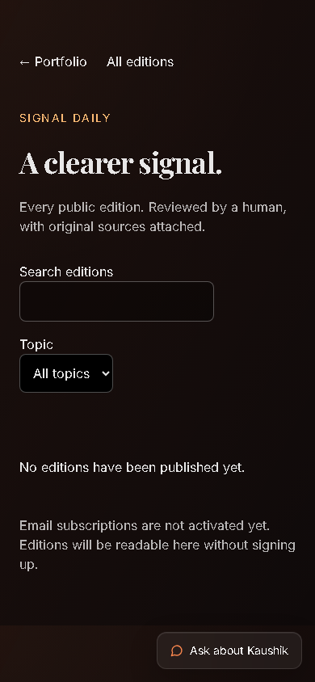

# Live portfolio and preview verification

23 October 2026. **The existing public portfolio works; Signal Daily is verified in preview only.** Production was deliberately left unchanged because the portfolio GitHub release job could not start under the account restriction. A deployed preview does not mean the newsletter is live at the production alias.

| Surface | Revision / deployment | Browser outcome |
|---|---|---|
| [Public portfolio](https://kaaush.vercel.app/) | main `fd0f0be68e9434854ffb702928c2fadd92ced17d`; `dpl_6Cx1bVxuhwKC6dUUeECTo3m6bQPf` | 35 checks PASS; no newsletter section; `/newsletter` renders existing 404 |
| [Protected remediated preview](https://kaushik-aky7tp2xe-kaushik-yellanki-project.vercel.app/) | `7909c58e409bf316d57d2c2d17c85f6ea144979f`; `dpl_E85SZC6rUtkAZCaNKsr7MxScSHN9` | 39 checks PASS; newsletter homepage section and direct archive/missing-edition routes |
| Isolated local fictional content | Same frontend sources/updated dependencies; temporary approved synthetic catalog | 12 existing + 39 expanded checks PASS; fixture removed before commit/deployment |

Both actual HTTPS sites were exercised in Chromium. Checks cover the 9 original home sections, all 10 project, 5 experience and 8 challenge routes, zero uncaught page errors and 390px layout. Preview checks add Signal Daily after contact, keyboard archive navigation, search/select focus, disabled signup, empty archive and unapproved/missing slug behavior. The 9 original section text hashes and 23 detail headings are identical between production and the remediated preview. This is not a paid chatbot/provider API test or a full accessibility certification.

The fictional individual edition, source links, search/topic filtering and intercepted signup were verified only in the isolated local environment. The exact-commit preview has an empty catalog, so its individual-route test correctly shows “Edition not found”; no fictional edition is represented as live preview news. Local newsletter WCAG A/AA Axe analysis reported zero violations in the scoped main region. No real signup, draft approval, news publication or email send occurred.

Private deployment metadata confirmed the project/team, feature SHA/ref, READY state and preview environment. Final inspection of `kaaush.vercel.app` still identifies the original production deployment and aliases. No merge or production deployment was requested. Preview protection stayed enabled and the development credential was scoped to its exact origin.

Privacy verification checked 103 Git candidates and 3 local built JS/HTML assets against the available private local token and known credential signatures; deployed verification fetched 2 actual same-origin JS/CSS assets. No matches or fictional fixture markers were detected, the public JSON catalog is empty, and no signup form is active in the preview. These are bounded checks, not exhaustive secret discovery. The private database, local environment files, model output and test credentials remain ignored and were not uploaded to Git or Vercel.

[Full preview observations](portfolio-release-evidence/browser-preview.json), [production observations](portfolio-release-evidence/browser-production.json), [local fixture observations](portfolio-release-evidence/browser-local.json), [deployed privacy](portfolio-release-evidence/deployed-privacy.json), [deployment identity](portfolio-release-evidence/deployment.json).

Release decision and owner recovery steps are in [release readiness](PORTFOLIO_RELEASE_READINESS.md). Live reader-only release and real inbox delivery remain separate gates.
